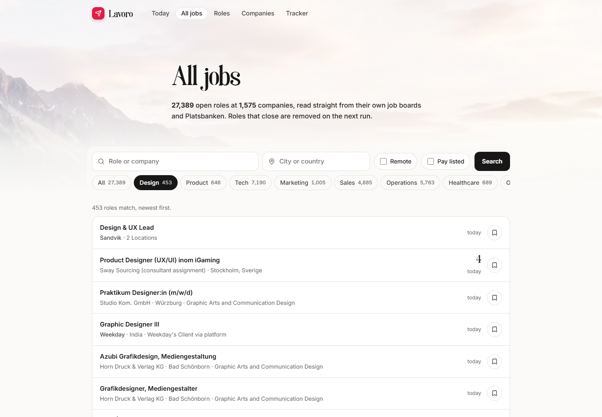
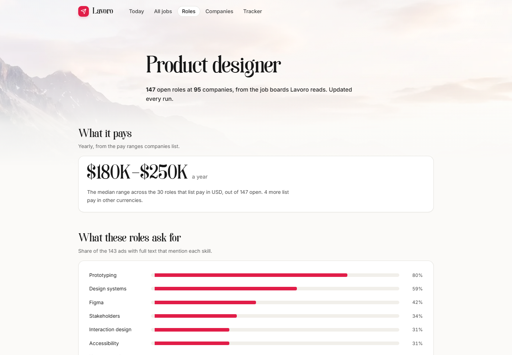
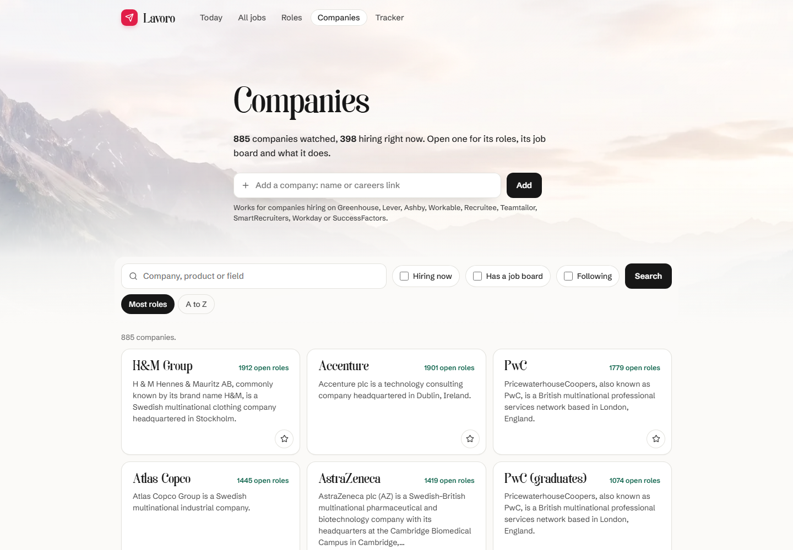

# Lavoro

*Lavoro* is Italian for "work". It is a job-search assistant that runs on your own computer. Each morning it does four things:

1. **Finds new roles** at startups and tech companies, straight from the companies' own job boards. Roles often appear there before they reach the big job sites.
2. **Scores each role** against your profile, with a short reason and any red flags.
3. **Finds the person who leads hiring** for each good match (the future manager, not a recruiter inbox) and their work email.
4. **Drafts a short email** in your voice, using only facts from your profile.

You read the drafts on a local page, at http://127.0.0.1:8765, and send the ones you like from your own Gmail. **Lavoro never sends anything by itself.**

The AI steps run through Claude Code on your existing Claude plan. You don't need an API key and you don't pay per token.


| | |
|---|---|
|  |  |
|  | |

## Quick start: let Claude set it up

1. Install [Claude Code](https://claude.com/claude-code) and sign in with your Claude account.
2. Clone this repository:

   ```bash
   git clone https://github.com/<you>/lavoro.git
   ```

3. Open Claude Code in the `lavoro` folder.
4. Say: **"Set up Lavoro for me."**

Claude installs what's needed and asks for your CV or LinkedIn text. It then asks which roles and places you want, builds the company list, does a first run, and opens the site. After that, type `/morning-run` any day, or press **Find new jobs** on the site.

## Quick start: the welcome screen

1. Install the packages:

   ```bash
   pip install -r requirements.txt
   ```

2. Start the site:

   ```bash
   python -m lavoro serve --open
   ```

3. On the welcome screen, drop your CV (PDF, Word or text) or paste your portfolio link. Lavoro reads it with Claude and writes your `profile.md`, using only facts from your CV or site.
4. Check the roles and cities it suggests, then press **Find my first jobs**.

The first search builds the company list too, so it takes 5 to 10 minutes.

LinkedIn profiles can't be read by other tools, so use LinkedIn's **More → Save to PDF** and drop that file.

## Manual setup

These steps go in order.

1. Install the packages. This needs Python 3.10 or newer.

   ```bash
   pip install -r requirements.txt
   ```

2. Check that Claude answers through your plan:

   ```bash
   python -m lavoro ai-check
   ```

3. Fill in your files. The ai-check in step 2 already created `profile.md` and `config.yaml` from the example files.
   - In `profile.md`, write who you are.
   - In `config.yaml`, set the roles, seniority and locations you want.

4. Build the company list. This takes a few minutes.

   ```bash
   python -m lavoro seed-yc
   ```

   ```bash
   python -m lavoro detect --limit 1000
   ```

5. Do the first run:

   ```bash
   python -m lavoro run
   ```

6. Open the site:

   ```bash
   python -m lavoro serve --open
   ```

## How it works

| Step | Command | What it does |
|---|---|---|
| Company list | `seed-yc`, `add`, `probe` | Seeds Y Combinator companies that are hiring, plus any company you add by website or name. |
| Board detection | `detect` | Finds each company's job board: Greenhouse, Lever, Ashby, Workable, Recruitee, Teamtailor, SmartRecruiters, Workday or SAP SuccessFactors. Workday and SuccessFactors boards (used by big employers such as Volvo) cannot be guessed from a name: add them by pasting the careers link. |
| Fetch | `fetch` | Reads every open role from each board's public feed. No key needed. It also reads the latest Hacker News "Who is hiring?" thread (posts often include the founder's email), [Arbeitnow](https://www.arbeitnow.com)'s free European job API, and, in Sweden, Platsbanken through the JobTech API. |
| Web search | `web` | Claude searches the web for postings the boards miss: company career pages, local job sites and LinkedIn job listings. It reads search results only and never opens a LinkedIn page. Old LinkedIn ads, which search engines keep listing, are dropped. One Claude call per run. |
| Just raised | `funding` | Once a week, Claude finds companies in your region that announced a funding round in the last weeks. They tend to hire next. Lavoro looks for their job boards. |
| Match | `match` | Applies a quick title, location and company filter, then Claude scores what's left from 0 to 10. |
| Contacts | `contacts` | Finds the hiring person for top roles. See "Where emails come from" below. |
| Draft | `draft` | Writes one short email per role. |
| Site | `serve` | Shows the local site. Its buttons save to your local database. |

The site has five pages:

| Page | What it shows |
|---|---|
| **Today** (`/`) | The emails ready to send, new roles at companies you follow, and the good matches still waiting for a contact. The region picker sets where the daily run searches. |
| **All jobs** (`/jobs`) | Every open role, searchable by role, company and place. Filters: category (Design, Product, Tech, Marketing, Sales, Operations, Healthcare, Other), Remote, and Pay listed. |
| **Roles** (`/roles`) | For any role, e.g. `/roles/product-designer`: what it pays (from listed pay ranges), the skills its ads ask for, how many roles disclose pay, mention equity, are remote or mention visas, who is hiring, and the newest roles. |
| **Tracker** (`/tracker`) | A spreadsheet of what you're going for: company, role, stage (Interested, Will apply, Applied, Emailed, Followed up, Interviewing, Offer, Not this time), contact, dates and notes. Edit any cell and it saves. Applied and emailed roles get a follow-up date a week later, and Today lists follow-ups that are due. Press **Track** on any scored role, or mark an email as sent, to add it. **Download for Excel or Sheets** saves it as a CSV file. Each row opens a page with two helpers written by Claude from your profile: an **application kit** for careers-site applications (a cover letter, the CV points the ad cares about most, words to mirror, and what the ad asks for that your profile doesn't show) and a **follow-up email** for when a week has passed without an answer. |
| **Companies** (`/companies`) | Every company watched, with Hiring now, Has a job board and Following filters. Each company has its own page with links and its open roles. Press the star to follow a company: every new role it posts shows up on Today, whatever the title. To add a company, type its name or paste its careers link in the box at the top; Lavoro finds its job board and pulls its open roles. From the command line: `python -m lavoro add "Company name"`. |

`python -m lavoro run` runs fetch → web → funding → match → contacts → draft. Started from the site, it shows as a live timeline: what Lavoro read, where it searched, who just raised, the roles that fit, who to email and the emails written. The other commands are `list`, `mark`, `stats`, `digest` (a static HTML file instead of the site) and `ai-check`.

### Where emails come from

Sources are tried best first:

1. **A contact printed in the ad.** Platsbanken ads often have one.
2. **Claude searching public pages** (team pages, press, search results) for the likely team lead. At small companies this is often the founder or CTO. It leaves the name empty rather than invent one.
3. **[Hunter.io](https://hunter.io)**, optional, if `HUNTER_API_KEY` is set. It gives verified addresses and each company's email format.
4. **The company's email format**, learned from other addresses on the same domain, or else a plain guess.

Every address shows how far you can trust it:

| Label | Meaning |
|---|---|
| **Listed in the ad** | Printed in the job ad. |
| **Verified** | Hunter confirmed the address. |
| **Likely** | Built from the company's known email format, on a domain that takes email. |
| **Guessed, check first** | Unconfirmed. Check it before you send. |

Before a built or guessed address is shown, Lavoro checks that its domain has a mail server, by asking a public DNS resolver about the domain name only. An address on a domain that takes no email is dropped. Nothing is ever sent to the address to test it.

## Plan usage

These are typical amounts per item. They count toward your Claude plan's usage limits; there is no bill.

| Step | Tokens per item |
|---|---|
| Score one role | About 1–2k |
| Find one hiring person (web search) | About 40k, mostly small Haiku search calls |
| Draft one email | About 3–5k |

Each Claude call starts without your plugins, skills, MCP servers or CLAUDE.md, which keeps it small.

`contacts.max_jobs_per_run` (default 15) is the main setting for how much of your plan a run uses.

If a run hits your plan limit, it stops cleanly and carries on next time. To pay per token instead, set `llm.backend: api` and `ANTHROPIC_API_KEY`.

## Region

Set where Lavoro searches with `search.region` in `config.yaml`, the picker on Today, or the command line:

```bash
python -m lavoro region europe
```

| Region | Counts as a match |
|---|---|
| `sweden` | Places in Sweden, plus remote roles open to Sweden, the Nordics, Europe or anywhere. Searches all of Platsbanken. |
| `nordics` | Sweden, Norway, Denmark, Finland and Iceland, plus remote roles open to the Nordics, Europe or anywhere. |
| `europe` | Places across Europe and the UK, plus remote roles open to Europe, EMEA or anywhere. |
| `asia` | South, Southeast and East Asia plus the Middle East: India, Singapore, Japan, Korea, China, Hong Kong, Indonesia, Vietnam, the Philippines, the UAE, Israel and more. Also remote roles open to Asia, APAC or anywhere. Platsbanken is off. |
| `worldwide` | Any place. |
| `custom` | Your own `locations_include` and `remote_regions` lists. |

To search a different region for one run only:

```bash
python -m lavoro run --region nordics
```

Changing the region sends jobs the old region skipped back through the filter on the next run. That run also refreshes the YC company list for the new region.

## Every morning, automatically

- **Windows:** Task Scheduler → Create Basic Task → Daily → Start a program → `run_daily.bat`. Run the task as your own user, so the `claude` login is available. Turn on "Run task as soon as possible after a scheduled start is missed". The log goes to `output/run.log`. Extra arguments are passed on, e.g. `run_daily.bat --region europe`.
- **Once a week** the daily run also refreshes the YC company list and finds new job boards (`search.yc.refresh_days`).
- **macOS/Linux:** add a cron line:

  ```
  30 7 * * * cd /path/to/lavoro && python -m lavoro run
  ```

- **In Claude Code:** type `/morning-run`.
- **A notification when it's done:** after the morning run, your computer shows a note such as "2 new emails ready · 1 follow-up due". Clicking it opens Lavoro; the site starts in the background first if it isn't running. Turn it off with `notify.enabled: false`. Try it with `python -m lavoro notify --test`.

## Optional: drafts straight into Gmail

1. Install the Gmail packages:

   ```bash
   pip install -r requirements-gmail.txt
   ```

2. Follow the steps at the top of `lavoro/gmail.py`.
3. Set `email.gmail_drafts: true` in `config.yaml`.

It uses the `gmail.compose` scope: Lavoro can create drafts but cannot read your inbox.

## Privacy and good manners

- **Everything stays on your computer.** Your profile, settings, the database and the drafts are gitignored: `profile.md`, `config.yaml`, `data/`, `output/`.
- **The site only answers on 127.0.0.1.**
- **Send each email yourself, one at a time, with a real reason to write.** Low volume keeps your sender reputation healthy and respects privacy and anti-spam rules such as GDPR and CAN-SPAM.
- **If someone says no, or doesn't answer twice, stop.** Press **Not for me**.
- **Lavoro does not scrape LinkedIn or log into any site.** It reads public job feeds, company websites and search results only. A LinkedIn job found by web search is kept as a title, a company and a link for you to open yourself.
- **Your tracker stays local too.** It lives in `data/lavoro.db`, like everything else.

## Terms and privacy

By using Lavoro you accept its [terms of use and privacy notice](https://thiyanesh047-del.github.io/lavoro/legal.html) (also at http://127.0.0.1:8765/legal while Lavoro runs, and in [docs/legal.html](docs/legal.html)). In short: Lavoro runs on your computer and only drafts. You decide what it does and what you send, so you are responsible for how you use it. It comes as is, with no warranty and no liability.

## License

The code is MIT licensed. See [LICENSE](LICENSE).

## Credits

- **Display font:** [Soria](https://www.fontsquirrel.com/fonts/soria) by Bydani. It is included unmodified under [CC BY-ND 4.0](https://creativecommons.org/licenses/by-nd/4.0/); see `lavoro/static/soria-NOTICE.txt`.
- **Fallback display font:** Instrument Serif, loaded from Google Fonts.
- **Text font:** Inter, loaded from Google Fonts.
- **European jobs:** from the free [Arbeitnow](https://www.arbeitnow.com) job board API.
